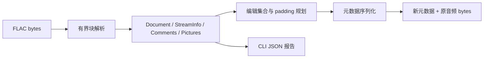

# MoonFlacTag

一个为 MoonBit 生态提供 FLAC 标签、封面与无损元数据改写能力的开源项目。

目标用户：音乐归档、播客整理、媒体上传与批量标签工具开发者。场景是改标题/作者、增删封面，而不重新编码音频；未知块、应用信息、seektable 等应保留。具体生态证据见两份生态报告。

已有 rodio/FFmpeg 提供解码和播放，HexEditor 提供字节编辑；本项目提供独立的纯 MoonBit 元数据事务 API。原创实现，以 RFC 9639 为格式依据，MIT 许可，无第三方运行时模块依赖。

根包拥有公开类型与核心逻辑，按 wire/comments/picture/document/edit 拆分。cmd/main 仅为 Node.js 文件 I/O 和参数适配；核心支持 Wasm-GC 与 JS。文件读取有上限，核心限制累计元数据、块数与长度；坏输入用结构化错误拒绝。编辑不修改输入 Document；输出由调用方另存。

MVP：native FLAC 文件签名与 STREAMINFO、重复 Vorbis comments 的大小写无关 set/remove/add、PICTURE 编解码、padding compact/exact/preserve-offset、未知块和音频后缀保留、编辑报告、可运行 CLI 和 Demo、公开 API 测试、FFmpeg/ffprobe 独立对照、打包后独立消费、文档与一页申报草稿。

限制：整个文件在内存中；不解码/校验音频帧、MD5 或 CRC；不支持 Ogg-FLAC/ID3 前缀；不解析 cuesheet 的内部语义；PICTURE 只校验元数据结构，不解码图片或获取 URI；写新文件，不提供原地文件事务。音频完整性声明限于 bytes 保留和测试 fixture 的独立解码对照。

验证：手工 bytes 覆盖端序、长度、重复块、UTF-8、截断、24 位上限；FFmpeg 生成 sine FLAC，ffprobe 对照标题/封面与流参数，解码 PCM 对照。核心跨 Wasm-GC/JS 输出一致。文档记录实际工具链。仅支持已执行验证的范围。

三分钟演示：0-30 秒说明标签编辑为何无需重编码；30-100 秒 inspect、set 标题、重复 ARTIST 与封面编辑；100-150 秒展示 padding 保持音频偏移与预算不足错误；150-180 秒对照音频 bytes、PCM、测试和可复用 API。未来再考虑流式宿主与其他媒体格式。

2026-10-17 通过官方 [App.tsx](https://github.com/moonbitlang/Hackathon2026/blob/main/src/App.tsx) 重核十月赛：10 月 31 日报名/验收截止，十月最多提交 3 次，每队不超过 3 人，公开持续开发、MoonBit 主体、可复现演示与测试、开源合规。JS 页面正文通过 raw GitHub 获取，原件在本地 research/rules.tsx。

本次按用户指示仅本地交付。公开仓库、真实作者、Mooncakes namespace 和参赛者信息待指定；local/moonflactag 是开发占位名。本地 Git 使用中性身份保存真实阶段历史，尚无公开开发或报名记录。

## 0.2.0 本地完善（2026-10-19）

上文是 0.1.0 原始 MVP 方案。本次在相同项目边界内补齐 RewritePlan / Document.plan / plan_metadata，CLI 的 plan 预览和 --padding；文件层改为最多 16 MiB 前缀与 1 MiB 分块后缀复制，移除 256 MiB 整文件限制。普通读写/fsync 失败清理输出，源变化时拒绝保存。新增 seektable 顺序/placeholder 和单例块检查。累计元数据限制维持不变，内存 rewrite API 保持兼容。

新增四组 FFmpeg 对照、268439553 bytes 合成大文件和六类宿主故障验证。两后端当前各 23 测试，含 2 文档测试；跨后端 plan 示例相同，实际 0.2.0 归档独立消费。新增 FLAC 解码库的读取能力已在生态报告中列明，编辑/写出仍为本项目独立贡献。具体范围和状态以 docs/acceptance-review.md 为准。

## 0.3.0 后续完善（2026-10-22）

按真实使用缺口新增内置目录批量、按类型保留/编辑封面及 PNG/JPEG 导出，补上固定错误字段、临时文件原子发布和元数据按需读取。新增第二编码路径 libsndfile、复杂标签和确定性畸形输入验证；每后端 31 测试，实际归档消费各 2 项。性能基线实际记录读取量/耗时/峰值 RSS，未将单次合成样本作为通用性能保证。原 API、旧 PNG 全替换入口保持兼容。交付仍仅本地，当前状态见新版验收报告。

2026-10-22 继续完善至 0.4.0：按命令行实际使用补齐独立 Node 运行包、离线安装、自动空间、批量恢复/进度、UTF-8 报告和使用手册；既有核心与 API 保持。当前证据见验收复核。
